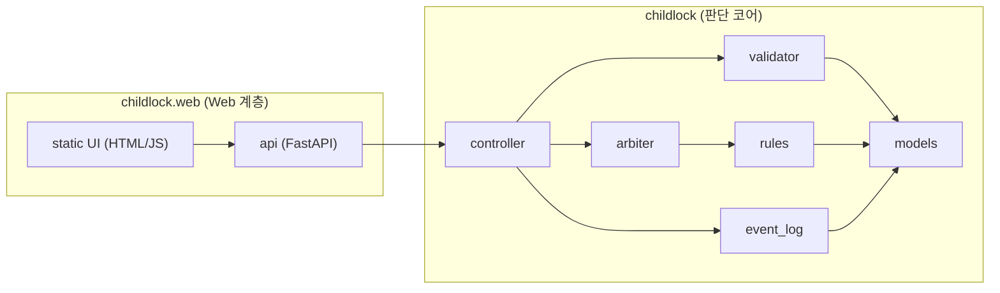
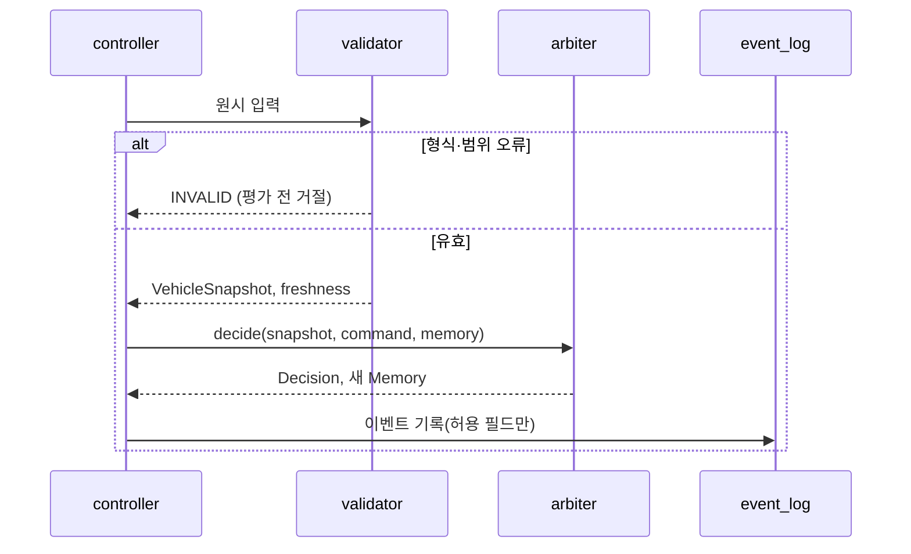

# 아키텍처 설계

- 베이스라인: `BL-SWA-1.0` (초안)
- 입력 문서: `docs/01_requirements/01_swr.md`, `00_decisions.md`
- 실행 환경: Python 3.12 이상, PC/SIL. 표준 라이브러리와 FastAPI(Web 계층만)를 사용한다.

## 1. 설계 원칙
1. **판단 로직은 순수 함수로 둔다.** `decide()`는 입력과 이전 기억(`Memory`)만으로 결과와 새 기억을 만든다. 시계, 난수, 파일, 네트워크를 직접 쓰지 않는다. 이것이 결정론(SWR-016)의 근거다.
2. **시간은 입력으로 받는다.** 평가 시각은 `VehicleSnapshot.timestamp_s`이고 시계 객체는 주입한다.
3. **안전 로직과 Web 계층을 분리한다.** 판단 코어(`childlock`)는 Web 계층(`childlock.web`)을 알지 못한다. 의존 방향은 Web → 컨트롤러 → 코어 한 방향뿐이다.
4. **함수는 작게 둔다.** 규칙 하나가 함수 하나이며, 모든 함수는 문장 50개 이하, 순환 복잡도 10 이하다.

## 2. 구성도

## 3. 모듈 책임과 SWR 매핑

| 모듈 | 파일 | 책임 | 주요 SWR |
|---|---|---|---|
| models | `src/childlock/models.py` | 열거형(`LockOutput`, `CrashStatus`, `Gear`, `State`, `ReasonCode`)과 불변 데이터(`VehicleSnapshot`, `DriverCommand`, `Memory`, `Decision`) | 전체 |
| validator | `src/childlock/validator.py` | 원시 입력(dict)의 형식·범위 검증, `INVALID` 판정, freshness 계산 | SWR-013 |
| rules | `src/childlock/rules.py` | 개별 규칙 함수. 각 규칙은 "이 조건이 출력을 정하는가"를 반환한다. | SWR-003~009, 017, 018, 020, 021 |
| arbiter | `src/childlock/arbiter.py` | 우선순위표 순서로 규칙을 평가해 `Decision`을 만든다(`decide`). | SWR-022 |
| event_log | `src/childlock/event_log.py` | 이벤트 ID 부여, 허용 필드만 저장, 최근 100건 링 버퍼 | SWR-010~012 |
| controller | `src/childlock/controller.py` | 50 ms 평가주기 오케스트레이션, 시계 주입, 기억 보관 | SWR-016, 023 |
| api | `src/childlock/web/api.py` | 상태조회, 시험 입력, 이력 조회, 직렬화(HTTP 500 처리) | SWR-014 |
| UI | `src/childlock/web/static/` | 입력 전송과 상태·이유코드 표시 | SWR-015 |

## 4. 데이터 모델

| 이름 | 필드 |
|---|---|
| `VehicleSnapshot` | `timestamp_s`, `source_timestamp_s`, `vehicle_speed_kph`, `gear`, `crash_status`, `rear_left_approach_risk`, `rear_right_approach_risk`, `fire_detected`, `overtemperature_detected`, `adult_present`, `isofix_left`, `isofix_right`, `ignition_on`, `sensor_fault` |
| `DriverCommand` | `side`(`left`/`right`/`all`), `action`(`lock`/`unlock`), `source`(`physical_button`/`avn`/`voice`/`mobile_app`) |
| `Memory` | `last_left`, `last_right`, `suppressed_since_ms_left`, `suppressed_since_ms_right`, `event_counter` |
| `Decision` | `lock_left`, `lock_right`, `state`, `reason_code`, `priority_reason`, `input_validity`, `override` |

설계 결정:
- **DD-001** 사양서에는 `source_timestamp_s`가 `OEM-IF-001`에만 있으므로, 이 값을 스냅샷 전체의 신호 시각으로 본다. freshness는 `timestamp_s − source_timestamp_s`를 밀리초 정수로 반올림해 200 ms 초과 여부로 판단한다(DEC-007).
- **DD-002** 모든 시각 비교는 밀리초 정수로 한다. 부동소수점 비교를 쓰지 않는다.
- **DD-003** 접근위험 억제 시각은 측별로 기억한다(`suppressed_since_ms_*`). 해제 요청이 처음 억제된 시각을 기록하고, 접근위험이 FALSE가 되면 지운다.

## 5. 상태

| 상태 | 진입 조건 | 출력 |
|---|---|---|
| `OFF` | `ignition_on=FALSE` | 좌·우 `RELEASE` (ISOFIX 측은 `LOCK` 유지) |
| `NORMAL` | 위 조건이 모두 아님 | 우선순위표 결과 |
| `DEGRADED` | 필수 입력 stale | 직전 출력 유지 |
| `FAULT` | `sensor_fault=TRUE` | 직전 출력 유지 |

## 6. 평가주기 흐름

`decide()` 평가 순서는 `00_decisions.md`의 우선순위표(0~8)를 따른다. 순위 0은 `validator`와 `arbiter` 앞단에서 처리한다.

## 7. 사유코드 (`ReasonCode`)

| 코드 | 의미 | SWR |
|---|---|---|
| `CRASH_CONFIRMED` | 충돌 확정 해제 | SWR-007 |
| `CRASH_PENDING` | 충돌 미확정, 출력 유지 | SWR-008 |
| `FIRE` / `OVERTEMPERATURE` / `ADULT_PRESENT` | 비상 강제 해제 | SWR-017 |
| `SENSOR_FAULT` | 센서 고장, 출력 유지 | SWR-021 |
| `APPROACH_RISK_LEFT` / `APPROACH_RISK_RIGHT` | 접근위험 잠금 | SWR-005 |
| `APPROACH_OVERRIDE` | 재입력 override | SWR-006 |
| `ISOFIX_LEFT` / `ISOFIX_RIGHT` | ISOFIX 강제 잠금 | SWR-018 |
| `IGNITION_OFF` (표시값 `ignition_off`) | 시동 OFF 해제 | SWR-020 |
| `AUTO_LOCK_SPEED` | 이동 시작 자동 잠금 | SWR-003 |
| `RELEASE_DENIED_MOVING` | 이동 중 해제 거절 | SWR-004 |
| `DRIVER_COMMAND` | 운전자 명령 적용 | SWR-001, 002 |
| `INPUT_STALE` | 입력 갱신 지연 | SWR-013 |
| `NO_CHANGE` | 변경 없음 | - |

## 8. Web 인터페이스 (SWR-014, 015)

| 메서드와 경로 | 설명 |
|---|---|
| `POST /evaluate` | 시험 입력(스냅샷과 선택적 명령)을 보내 한 주기를 평가한다. 형식 오류는 422로 거절하고 결정은 만들지 않는다. |
| `GET /status` | 최근 `Decision`(좌·우 출력, `state`, 입력 유효성, 이유코드). 직렬화 실패는 500. |
| `GET /events` | 최근 100건 이벤트 |
| `GET /` | 정적 시뮬레이터 화면 |

## 9. 품질·검증 설계
- 단위 테스트: 모듈별로 규칙 하나당 테스트를 두고 경계값(200 ms, 3.0 km/h, 10 s, 101건)을 포함한다.
- 통합 테스트: `controller`부터 `event_log`, `api`까지 평가주기 단위로 검증한다.
- 정적분석 계획: Ruff(`E`, `W`, `F`, `I`, `N`, `C901`, `PLR0915`)를 CI에서 실행한다. 실패하면 병합할 수 없다.
- 추적성: SWR → 모듈 → 테스트 ID 관계는 3단계에서 상세 설계와 함께 갱신한다.
