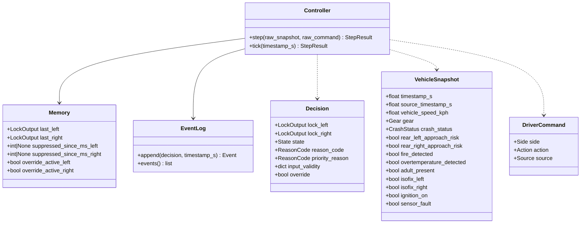
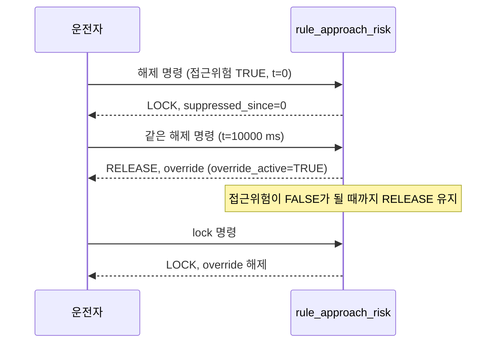
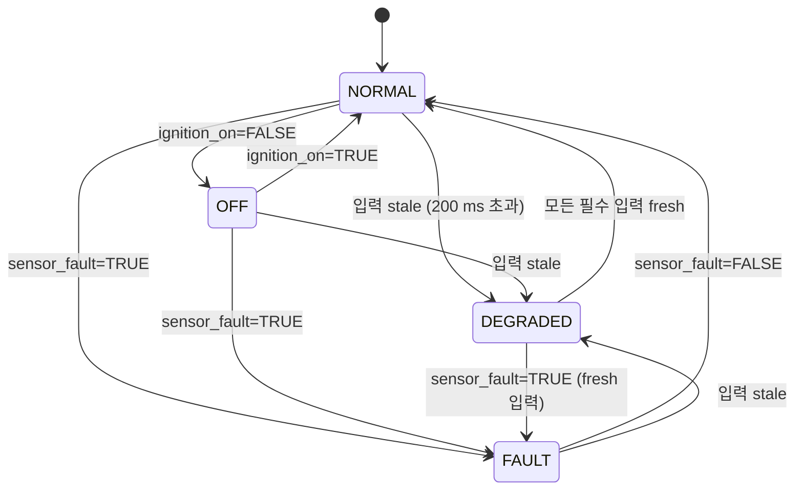

# 상세 설계

- 베이스라인: `BL-SWD-1.0` (초안)
- 입력 문서: `docs/01_requirements/01_swr.md`, `00_decisions.md`, `docs/02_architecture/architecture.md`
- 모든 함수는 문장 50개 이하, 순환 복잡도 10 이하로 설계한다. 복잡해지면 보조 함수로 나눈다.

## 1. 상수 (`models.py`)

| 상수 | 값 | 근거 |
|---|---|---|
| `CYCLE_MS` | 50 | SWR-023 |
| `STALE_MS` | 200 | SWR-013 (초과 시 stale) |
| `DEGRADED_DEADLINE_MS` | 100 | SWR-013 (검증 기준 값, 코드 동작에는 쓰지 않음) |
| `AUTO_LOCK_KPH` | 3.0 | SWR-003 (이상 시 잠금) |
| `OVERRIDE_WINDOW_MS` | 10_000 | SWR-006 (이하 시 override) |
| `LOG_CAPACITY` | 100 | SWR-012 |
| `SPEED_RANGE` | 0.0 ~ 300.0 | OEM-IF-001 |

## 2. 클래스 구조

모든 데이터 클래스는 `@dataclass(frozen=True, slots=True)`다. `Memory`는 `decide()`가 새 인스턴스를 반환한다.

## 3. validator (`validator.py`)

| 함수 | 시그니처 | 동작 | SWR |
|---|---|---|---|
| `parse_snapshot` | `(raw: Mapping[str, object]) -> ParseResult` | 필드별로 읽기 함수를 호출해 오류를 모은다. 오류가 없으면 `VehicleSnapshot`을 만든다. | 013 |
| `parse_command` | `(raw: Mapping[str, object] \| None) -> CommandResult` | 명령이 없으면 `command=None`. `side`, `action`, `source`가 열거값이 아니면 거절한다. | 001, 002, 013 |
| `age_ms` | `(snapshot) -> int` | `round((timestamp_s − source_timestamp_s) * 1000)` | 013 |
| `is_stale` | `(snapshot) -> bool` | `age_ms(snapshot) > STALE_MS` | 013 |
| `_read_bool` | `(raw, key) -> tuple[bool \| None, str \| None]` | 누락 또는 `bool`이 아니면 오류. 정수 0/1은 거절한다. | 013 |
| `_read_enum` | `(raw, key, enum_cls) -> tuple[Enum \| None, str \| None]` | 누락 또는 미정의 값이면 오류 | 013 |
| `_read_float` | `(raw, key, low, high) -> tuple[float \| None, str \| None]` | 누락, `bool`, `NaN`, `inf`, 범위 밖이면 오류 | 013 |

- `ParseResult(snapshot, validity, errors)`: `validity`는 그룹별 `VALID` 또는 `INVALID`다. 그룹은 `speed`, `gear`, `crash`, `approach`, `emergency`, `isofix`, `ignition`, `sensor_fault`, `command`이다.
- `INVALID`인 입력은 평가하지 않는다. 오류가 있으면 `snapshot=None`이다.
- stale은 유효한 스냅샷에서만 판정하며, 그룹 `validity`에는 `STALE`을 쓴다.

## 4. rules (`rules.py`)

각 규칙은 `Verdict | None`을 반환한다. `None`이면 "이 규칙은 출력을 정하지 않음"이다. `Verdict(left, right, reason, state)`에서 `left`, `right`는 `LockOutput` 또는 `None`(해당 측은 정하지 않음)이다.

| 함수 | 시그니처 | 동작 | SWR |
|---|---|---|---|
| `rule_crash_confirmed` | `(snap) -> Verdict \| None` | `CONFIRMED`이면 좌·우 `RELEASE`, `CRASH_CONFIRMED` | 007 |
| `rule_emergency` | `(snap) -> Verdict \| None` | 화재, 과온, 성인 순서로 첫 TRUE를 찾아 좌·우 `RELEASE`, 입력별 이유코드 | 017 |
| `rule_sensor_fault` | `(snap, mem) -> Verdict \| None` | TRUE이면 직전 출력 유지, `FAULT`, `SENSOR_FAULT` | 021 |
| `rule_crash_pending` | `(snap, mem) -> Verdict \| None` | `PENDING`이면 직전 출력 유지, `CRASH_PENDING` | 008 |
| `rule_approach_risk` | `(side, snap, cmd, mem, now_ms) -> SideVerdict \| None` | 아래 5절 흐름 | 005, 006, 009 |
| `rule_isofix` | `(side, snap) -> SideVerdict \| None` | 해당 측 ISOFIX TRUE이면 `LOCK`, `ISOFIX_LEFT`/`ISOFIX_RIGHT` | 018 |
| `rule_ignition_off` | `(snap) -> SideVerdict \| None` | `ignition_on=FALSE`이면 `RELEASE`, `IGNITION_OFF` | 020 |
| `rule_auto_lock` | `(snap, cmd) -> SideVerdict \| None` | 차속 ≥ 3.0이면 `LOCK`. 해제 명령이 함께 오면 이유코드는 `RELEASE_DENIED_MOVING` | 003, 004 |
| `rule_driver_command` | `(side, cmd, mem) -> SideVerdict \| None` | 명령의 side가 해당 측이면 lock→`LOCK`, unlock→`RELEASE`, `DRIVER_COMMAND` | 001, 002 |

`SideVerdict(output, reason, override, suppressed_since_ms, override_active)`는 한 측의 결과와 갱신할 기억을 담는다.

## 5. 접근위험 흐름 (SWR-005, 006, 009, DD-004)

한 측에 대해 `rule_approach_risk`는 다음 순서로 판단한다.

1. 해당 측 접근위험이 FALSE이면 `suppressed_since`와 `override_active`를 지우고 `None`을 반환한다.
2. `override_active`가 TRUE이면: 이 측을 대상으로 한 `lock` 명령이 오면 `override_active`를 지우고 `LOCK`(`DRIVER_COMMAND`). 그 외에는 `RELEASE`를 유지한다(`APPROACH_OVERRIDE`, `override=True`).
3. 해제 명령이 이 측을 대상으로 오면:
   - `suppressed_since`가 있고 `now_ms − suppressed_since ≤ 10_000`이면 override 성립: `RELEASE`, `APPROACH_OVERRIDE`, `override_active=TRUE`.
   - 그렇지 않으면(처음이거나 10초 초과) `suppressed_since = now_ms`로 갱신하고 `LOCK`, `APPROACH_RISK_*`.
4. 그 외에는 `LOCK`, `APPROACH_RISK_*`.

## 6. arbiter (`arbiter.py`)

| 함수 | 시그니처 | 동작 |
|---|---|---|
| `decide` | `(snap, cmd, mem, validity) -> tuple[Decision, Memory]` | 아래 평가 순서를 적용한다. |
| `_decide_global` | `(snap, mem) -> Verdict \| None` | 순위 1, 2, 3, 3.5 (`crash_confirmed`, `emergency`, `sensor_fault`, `crash_pending`)를 순서대로 적용 |
| `_decide_side` | `(side, snap, cmd, mem, now_ms) -> SideVerdict` | 순위 4, 5, 6, 7, 8을 순서대로 적용하고 모두 `None`이면 직전 출력 유지(`NO_CHANGE`) |
| `_pick_priority_reason` | `(left, right) -> ReasonCode` | 두 측 이유 중 순위가 높은 것을 고르고 같으면 좌측 |
| `_state_for` | `(snap, verdict) -> State` | 전역 규칙의 상태가 있으면 그것, 없으면 시동 OFF면 `OFF`, 아니면 `NORMAL` |

`decide` 평가 순서:
1. `is_stale(snap)`이면 직전 출력 유지, `DEGRADED`, `INPUT_STALE` (순위 0).
2. `_decide_global`의 결과가 있으면 그것으로 확정한다.
3. 없으면 좌·우에 `_decide_side`를 각각 적용하고 `_pick_priority_reason`, `_state_for`로 `Decision`을 만든다.

`now_ms`는 `round(snap.timestamp_s * 1000)`이다. 순위표는 `00_decisions.md`를 따른다.

## 7. 상태 전이

상태는 매 주기에 입력만으로 결정되며 별도 전이 지연이 없다. 우선 적용 순서는 `DEGRADED` → `FAULT` → `OFF` → `NORMAL`이다.

## 8. event_log (`event_log.py`)

| 항목 | 설계 |
|---|---|
| `Event` | `event_id`, `timestamp_s`, `state`, `lock_left`, `lock_right`, `reason_code`, `priority_reason`, `input_validity`. 이 8개 외 필드는 가질 수 없다(SWR-011). |
| `EventLog.append(decision, timestamp_s)` | 카운터를 1 증가시켜 `event_id`를 부여하고 링 버퍼(`deque(maxlen=100)`)에 저장한다(SWR-010, 012). |
| `EventLog.events()` | 오래된 것부터 최신 순서로 최대 100건 반환(SWR-012) |
| 휘발성 | 모듈은 파일·DB에 쓰지 않는다. 프로세스를 다시 시작하면 비어 있다. |
| 거절 입력 | 형식·범위 오류로 거절된 입력도 `INPUT_INVALID` 이벤트로 기록하며 출력은 직전 값 그대로다. |

## 9. controller (`controller.py`)

| 함수 | 시그니처 | 동작 |
|---|---|---|
| `Controller.step` | `(raw_snapshot, raw_command=None) -> StepResult` | `parse_snapshot`, `parse_command` → 오류가 있으면 거절 이벤트 기록 후 반환 → 없으면 `decide` → `Memory` 갱신 → `EventLog.append` → 마지막 스냅샷 보관 |
| `Controller.tick` | `(timestamp_s) -> StepResult` | 입력이 새로 오지 않은 주기. 마지막 유효 스냅샷의 `timestamp_s`만 바꿔 `decide`를 다시 호출한다. 시간이 지나면 stale이 되어 `DEGRADED`가 된다. |
| `Controller.status` | `() -> StatusView` | 마지막 `Decision`과 입력 유효성을 반환한다. 아직 결정이 없으면 초기 상태(`RELEASE`, `OFF`)다. |

`StepResult(decision, accepted, errors)`. 초기 `Memory`는 좌·우 `RELEASE`, 억제 시각 없음, override 해제다.

## 10. Web (`web/api.py`, `web/static/`)

| 항목 | 설계 |
|---|---|
| 의존성 | `fastapi`, `uvicorn`, 시험용 `httpx` |
| `POST /evaluate` | 본문 `{snapshot, command?}`. 입력에 시각이 없으면 주입된 시계(`now_s`)로 채운다. 거절이면 422와 오류 목록, 성공이면 200과 `Decision` |
| `GET /status` | `Controller.status()` 직렬화. 직렬화 중 예외는 예외 처리기로 HTTP 500 |
| `GET /events` | `EventLog.events()` 직렬화 |
| `GET /` | `static/index.html` |
| 화면 | 입력 폼, 좌·우 출력, `state`, 이유코드, 입력 유효성, 최근 이벤트 표를 표시하고 `fetch`로 API를 호출한다. |

## 11. 추적성 (SWR → 설계 → 시험)

| SWR | 모듈 / 함수 | 단위 시험 파일 |
|---|---|---|
| 001, 002 | `validator.parse_command`, `rules.rule_driver_command` | `test_validator.py`, `test_rules_command.py` |
| 003, 004 | `rules.rule_auto_lock` | `test_rules_auto_lock.py` |
| 005, 006, 009 | `rules.rule_approach_risk` | `test_rules_approach.py` |
| 007, 008 | `rules.rule_crash_confirmed`, `rules.rule_crash_pending` | `test_rules_crash.py` |
| 010, 011, 012 | `event_log.EventLog` | `test_event_log.py` |
| 013 | `validator.*`, `arbiter.decide`(순위 0) | `test_validator.py`, `test_arbiter.py` |
| 014, 015 | `web.api` | `test_api.py` |
| 016, 023 | `controller.Controller`, `arbiter.decide` | `test_controller.py`, `test_determinism.py` |
| 017 | `rules.rule_emergency` | `test_rules_emergency.py` |
| 018 | `rules.rule_isofix` | `test_rules_isofix.py` |
| 020 | `rules.rule_ignition_off` | `test_rules_ignition.py` |
| 021 | `rules.rule_sensor_fault` | `test_rules_sensor.py` |
| 022 | `arbiter.decide` | `test_arbiter.py` |

테스트 파일은 `tests/childlock/` 아래에 두며, 파일 이름은 설계 단계의 계획이고 4단계에서 확정한다.
